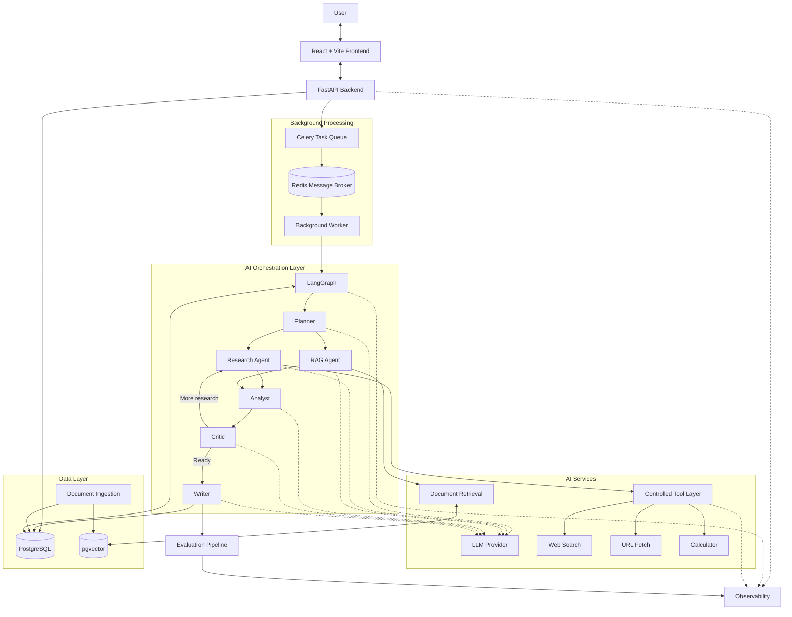

# System Architecture

## 1. Architecture Overview

The AI Research & Intelligence Platform follows a modular architecture consisting of a frontend, backend API, AI orchestration layer, RAG system, tool layer, database, observability, and evaluation components.

The system allows users to submit research questions, upload documents, perform web research, retrieve relevant information, and generate structured research reports using a multi-agent AI workflow.

## 2. Architecture Goals

- Maintain separation of responsibilities between components.
- Support long-running AI research tasks through background processing.
- Enable controlled communication between AI agents and external tools.
- Support document-based retrieval using RAG.
- Maintain persistent application and research data.
- Enable evaluation, observability, and debugging.
- Support future scalability and deployment.

## 3. High-Level Architecture Components

| Component | Technology | Responsibility |
|---|---|---|
| Frontend | React + Vite | User interface, research input, document upload, and report display |
| Backend API | FastAPI | API requests, authentication, validation, and response handling |
| AI Orchestration | LangGraph | Coordinate agents and manage research workflow |
| LLM Layer | LLM Provider | Reasoning, analysis, and content generation |
| RAG System | Python + Embeddings | Retrieve relevant information from uploaded documents |
| Tool Layer | Python Tools | Web search, URL fetching, document search, and calculator |
| Task Queue | Celery | Manage background research tasks |
| Message Broker | Redis | Deliver background task messages |
| Background Worker | LangGraph Worker | Execute AI research workflows |
| Database | PostgreSQL | Store application and research data |
| Vector Store | pgvector | Store embeddings and perform similarity search |
| Observability | LangSmith + Logging | Monitor execution, traces, latency, and errors |
| Evaluation | Evaluation Pipeline | Evaluate RAG, agents, and generated answers |

## 4. Component Responsibilities

### Frontend
- Provide the user interface.
- Accept research questions.
- Support document uploads.
- Display research progress and final reports.
- Allow users to submit feedback.

### Backend API
- Receive frontend requests.
- Handle authentication and validation.
- Create research jobs.
- Dispatch background tasks.
- Return job status and research results.

### AI Orchestration
- Coordinate AI agents.
- Manage workflow state.
- Control agent routing and execution.
- Manage conditional workflow transitions.

### RAG System
- Process uploaded documents.
- Generate document embeddings.
- Retrieve relevant document chunks.
- Provide context to the RAG Agent.

### Tool Layer
- Provide approved tools to agents.
- Execute web searches.
- Fetch web page content.
- Perform document searches.
- Execute calculations.

### Database
- Persist application data.
- Store research records and reports.
- Store document metadata and workflow records.

### Observability
- Capture structured logs.
- Track workflow execution.
- Monitor latency and errors.
- Support debugging and tracing.

### Evaluation
- Evaluate retrieval quality.
- Evaluate agent execution.
- Evaluate generated research reports.
- Produce evaluation metrics.

## 5. High-Level Architecture Diagram

## 6. Communication Methods

| From | To | Communication Method |
|---|---|---|
| React Frontend | FastAPI | HTTP REST APIs |
| FastAPI | LangGraph | Python integration through background worker |
| FastAPI | Celery | Task dispatch |
| Celery | Redis | Message broker |
| Redis | Background Worker | Task message delivery |
| Background Worker | LangGraph | Python integration |
| LangGraph | LLM | Model API calls |
| LangGraph | Tools | Python function calling |
| LangGraph | RAG | Python service integration |
| FastAPI | PostgreSQL | SQLAlchemy / Database connection |
| RAG | pgvector | Vector similarity queries |
| Components | Observability | Structured logs and tracing |
| Evaluation | AI Workflow | Evaluation pipeline |

## 7. Background Workflow Architecture

The platform uses background processing for long-running AI research tasks.

1. User submits a research request.
2. FastAPI validates the request and creates a research job.
3. The job is dispatched through Celery.
4. Redis acts as the message broker.
5. A background worker receives the task.
6. The worker invokes the LangGraph workflow.
7. AI agents execute the research process.
8. Job progress and final results are persisted in PostgreSQL.
9. Frontend retrieves job status through REST API polling.
10. The final report is displayed to the user.

### Research Job Lifecycle

- Pending
- Running
- Completed
- Failed

### Background Processing Technologies

| Technology | Responsibility |
|---|---|
| Celery | Background task management |
| Redis | Message broker |
| Background Worker | Task execution |
| LangGraph | AI research workflow |
| PostgreSQL | Persistent job status and results |

## 8. Architecture Decisions

| Decision | Selected Approach |
|---|---|
| Frontend | React + Vite |
| Backend | FastAPI |
| AI Orchestration | LangGraph |
| Background Processing | Celery |
| Message Broker | Redis |
| Database | PostgreSQL |
| Vector Search | pgvector |
| Frontend Communication | HTTP REST APIs |
| Job Status Updates | REST API Polling |
| Backend to AI Workflow | Python Integration |

## 9. Pending Architecture Sections

The following sections will be designed and documented in subsequent steps:

- Database Architecture
- External Services Architecture
- Complete Data Flow
- Security and Trust Boundaries
- Deployment Architecture